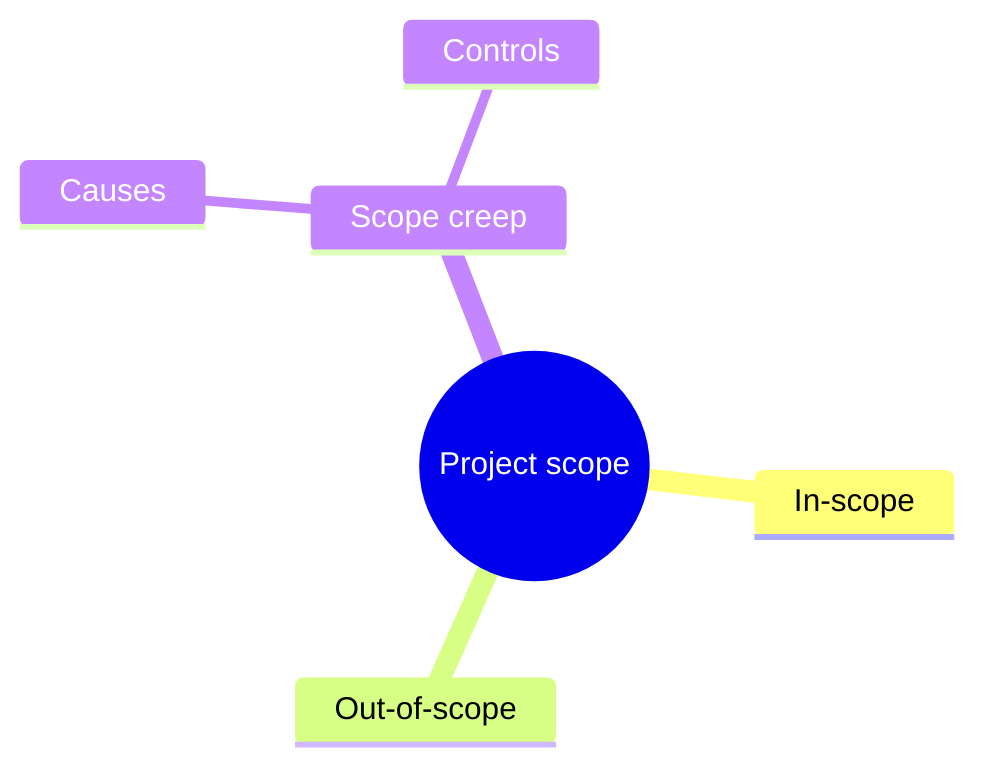
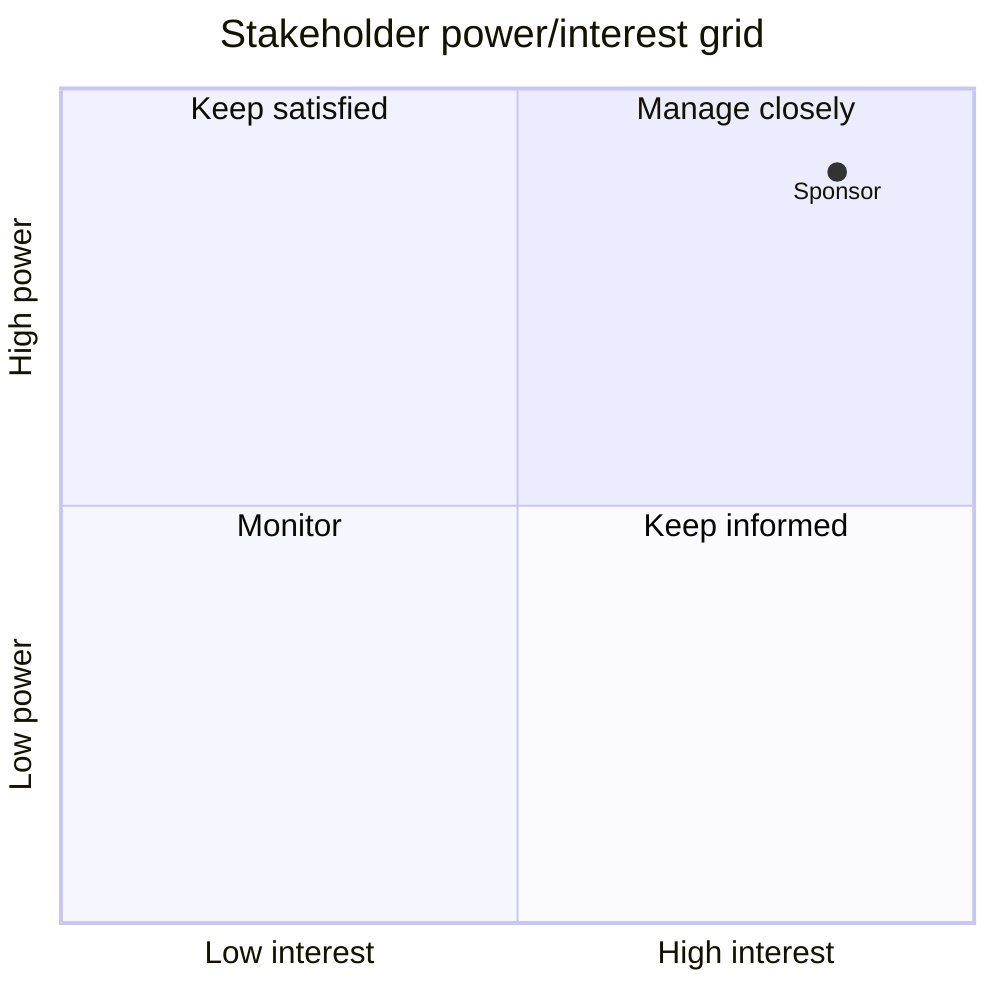

# Obsidian-native formats

The learner studies inside Obsidian, so every output must render there without extra tools. Only two community plugins are assumed: **Spaced Repetition** (required for flashcards) and optionally **Local REST API** (for the Obsidian MCP). Everything else is core Obsidian. Never produce HTML pages, web artifacts, or Excalidraw.

## Callouts (core)
```markdown
> [!abstract] Tóm tắt 1 phút
> …

> [!important] ⭐⭐⭐ Scope creep
> **Definition (course):** "…verbatim English…"
> **Hiểu nhanh:** một dòng tiếng Việt.

> [!example]- Ví dụ công việc        ← trailing "-" = folded by default
> …
```
Types used: `abstract`, `tip`, `important`, `warning`, `example`, `question`, `success`, `quote`. Folded (`-`) for answers and long examples.

## Mermaid (core) — first line must be the diagram type

- `mindmap` — quick map at the top of `summary.md`. Keep node text short; no parentheses/brackets inside node text except the root shape `((…))`.
- `flowchart LR` — processes and decision paths.
- `timeline` — phases (e.g. project life cycle).
- `quadrantChart` — 2×2 grids such as the stakeholder power/interest grid:

Use these to rebuild diagrams that appear as `*(image)*` in readings, based on the surrounding text — and say it is a reconstruction.

## Canvas mind map (core) — never hand-write the JSON
Write a nested-list outline, then run `scripts/build_canvas.py outline.md mindmap.canvas`:
```markdown
# Defining project goals, scope & success
- Goals
  - SMART goals
  - [[Coursera/_concepts/OKR]]
- Scope
  - [[Coursera/_concepts/Scope creep]]
  - In-scope vs out-of-scope
    - use the scope statement to decide
```
Level-1 = branches (5–8), level-2 = leaves; a leaf that is only a wikilink becomes a clickable file node; level-3 lines fold into the leaf text. Write the outline to a temp file, not into the vault.

## Spaced Repetition flashcards
File must contain a deck tag, e.g. `#flashcards/project-initiation-google/m02` on its own line near the top.
```markdown
What does SMART stand for?::Specific, Measurable, Attainable, Relevant, Time-bound
Scope creep:::Uncontrolled changes that expand a project's scope without adjusting time, cost or resources
The ==project charter== formally authorises the project.
```
`::` one-way, `:::` two-way, `==…==` cloze. One card per line, ≤ 25 words per side, no callouts around cards. Separate cards with a blank line.

## Practice tests
See `practice-test-guide.md` — tick boxes `- [ ]` for choices (not inside callouts), `Trả lời:: ` only for typed answers.

## Bases dashboard (core)
`assets/dashboard.base` → copy to `Coursera/_dashboard.base` once. It lists every `_study.md` with its frontmatter progress fields and every practice file with its score, so keep those properties up to date.

## Links and embeds
- Link: `[[full/path/to/file#^t0213|alias]]`. Embed a paragraph: `![[full/path#^p03]]`.
- Headings: `[[full/path#Heading text]]`.
- Tags: `#concept` on concept notes; `#flashcards/...` decks.
